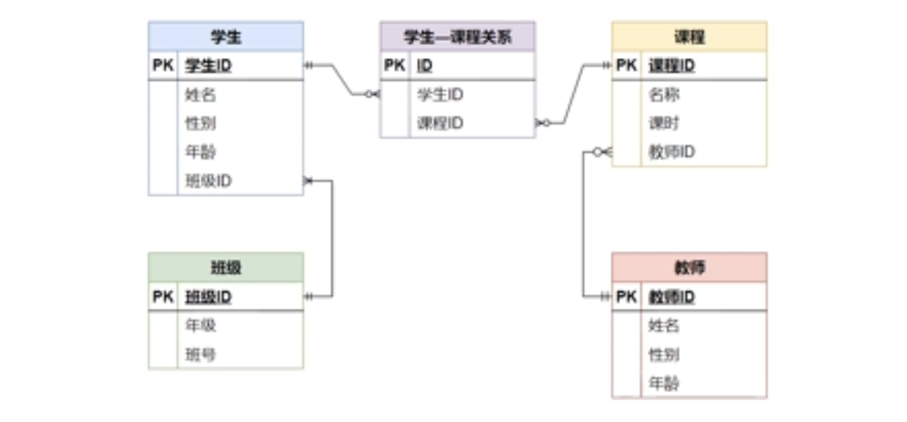
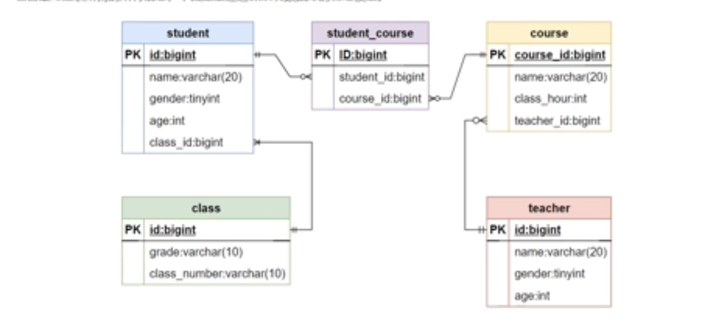

# 数据库设计

## 数据库设计理论

### 数据库模型
数据库设计中最常采用的模型为 `实体（Entity）关系（Relationship）模型`,简称ER模型。其核心思想是将现实世界中的复杂数据表示为一组实体。并
描述这些实体之间的关系。

- `实体`通常对应现实世界中的一个对象，例如：学生，班级，教师，课程。
- 每个实体都包含一组属性，这些属性用于描述实体，例如 学生实体 包含姓名，年龄，性别等属性。
- `关系`用于描述各实体之间的联系，例如学生和班级之间存在从属关系。

其中`关系`可分为 一对一，一对多，多对多三种，例如学生和班级之间的关系为 一对多，学生和课程之间的关系为 多对多。

实体关系模型通常使用 提示关系图（ER diagram） 进行表示，下图是一个简易的选课系统的实体关系图，其中方框代表实体，方框之间的连线则代表
实体间的关系，连线两端的不同符号用于表示 一对一，一对多，多对多 的关系。

上述符号通常是两个成对使用，其分别表示 最小值 和 最大值，例如上述ER图中的 班级 和 学生 之间的连线，
班级一册的符号表示 一 （最小值和最大值都是 一），学生一侧的符号表示 多 （最小值是 一， 最大值是 多），
其表达的含义就是班级和学生之间的关系为 一对多，一个学生只对应一个班级，而一个班级会对应多个学生（且至少
对应一个学生）。

### 数据库设计流程

传统的数据库设计流程分为三个阶段，分别是概念模型(Conceptual Model)设计阶段，逻辑模型(Logical Model)设计阶段和物理模型(Physical Model)设计阶段，
三个阶段由粗略到详细，由抽象到具体。

#### 概念模型设计

概念模型是一个粗略的初步设计，其只关注实体和关系，不体现最终建表所需的各种细节信息（例如实体的属性）。下图便是
一个典型的 简易 选课系统 数据库的概念模型。

#### 逻辑模型设计

相较于概念模型，逻辑模型会包含更多的细节信息，例如实体的属性，用于关联两个实体的字段等等。需要注意的是，逻辑
模型并不关注具体的数据库实现（例如MySQL和Oracle）.下图是上述选课系统数据库的逻辑模型。

#### 物理模型设计

相较于概念模型，物理模型会包含更多的与所选数据相关的具体信息，例如 存储引擎，字段类型，
索引等信息， 一般而言， 物理模型会包含最终建表所需的所有信息，下图是上述选课系统数据库的
物理模型。

