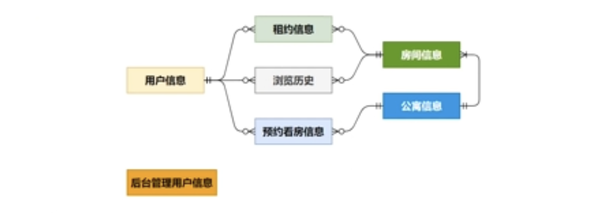
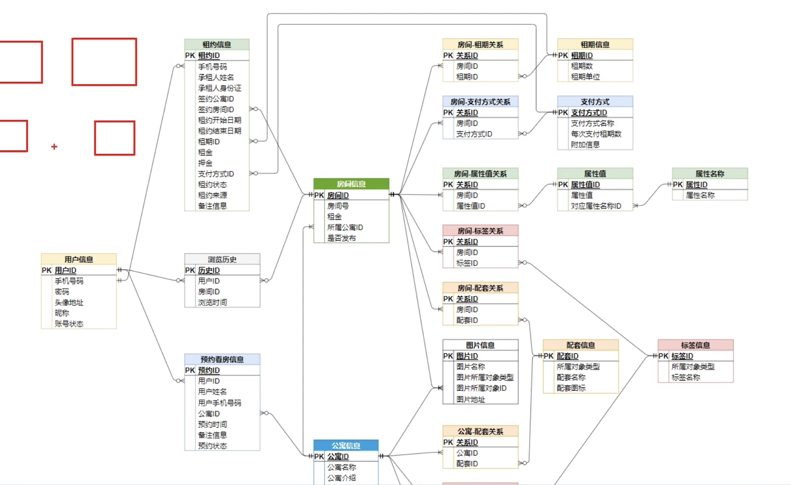
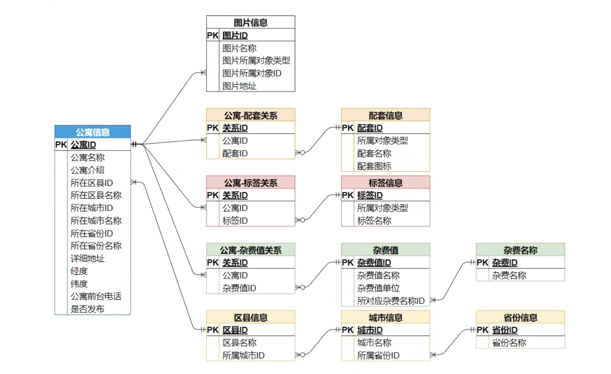
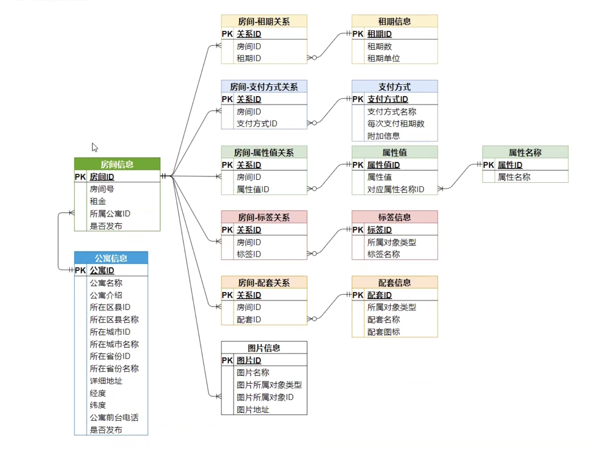
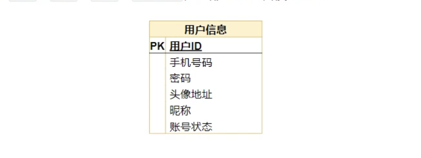
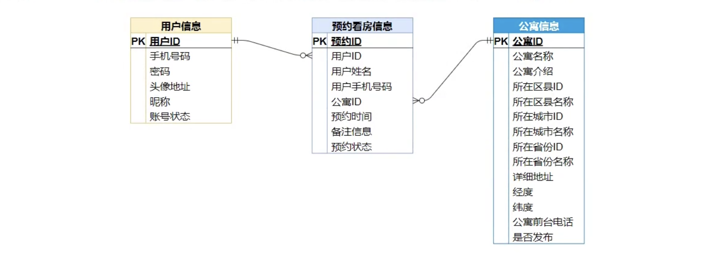
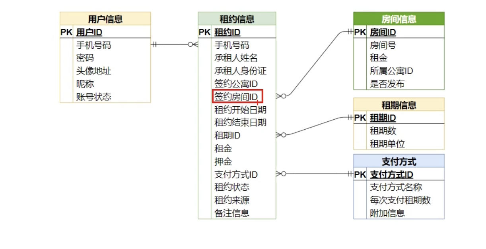
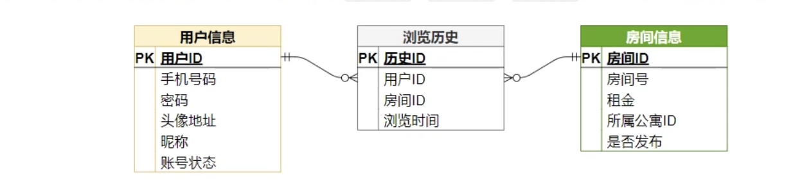
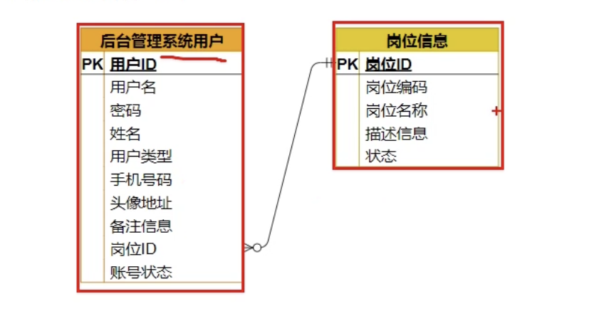

# 数据库设计

## 概念模型设计

根据圆形可得，本项目包含的实体有 公寓，房间，用户（租客），租约（合同），看房预约，浏览历史 和 后台管理系统用户，
各实体间的关系，如下：

## 逻辑模型设计

根据原型明确各实体所需属性并明确各表关联字段，得到的完整的逻辑模型
如下图所示。

### 1. 公寓信息

公寓信息包含的属性有：公寓名称，公寓简介，公寓联系方式，公寓图片，公寓标签，
公寓杂费，公寓发布状态， 这个不分的逻辑模型如下：

### 2. 房间信息

房间信息包含的属性有：房间号，房间租金，房间所属公寓，房间可选租期，房间可选支付方式，房间属性，
房间标签，房间配套，房间图片，房间发布状态，如图所示：

### 3. 用户信息

用户信息包含的属性: 手机号码，密码，头像，昵称，账号状态，如下：

### 4. 看房预约信息

看房预约包含的属性有： 预约用户信息，预约公寓信息，预约时间，备注信息，预约状态，如下：

### 5. 租约信息

租约信息包含：签约用户信息，签约房间信息，租期，支付方式，租约来源，押金。如下：

### 6. 浏览历史信息

浏览历史指的是：用户浏览房间详情的历史，包含的属性有：用户信息，房间信息，浏览时间，如下：

### 7. 后台管理用户信息

后台管理系统用户包含属性

## 物理模型设计

本项目采用MySQL数据库，